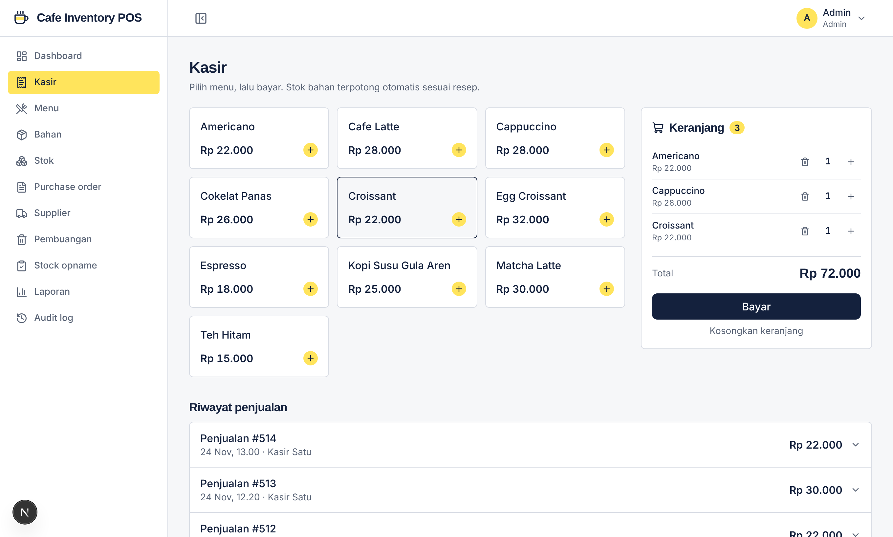
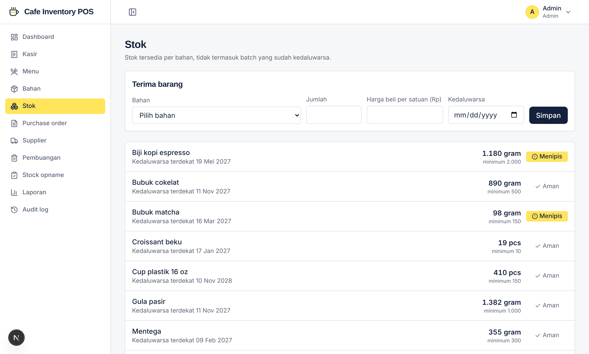
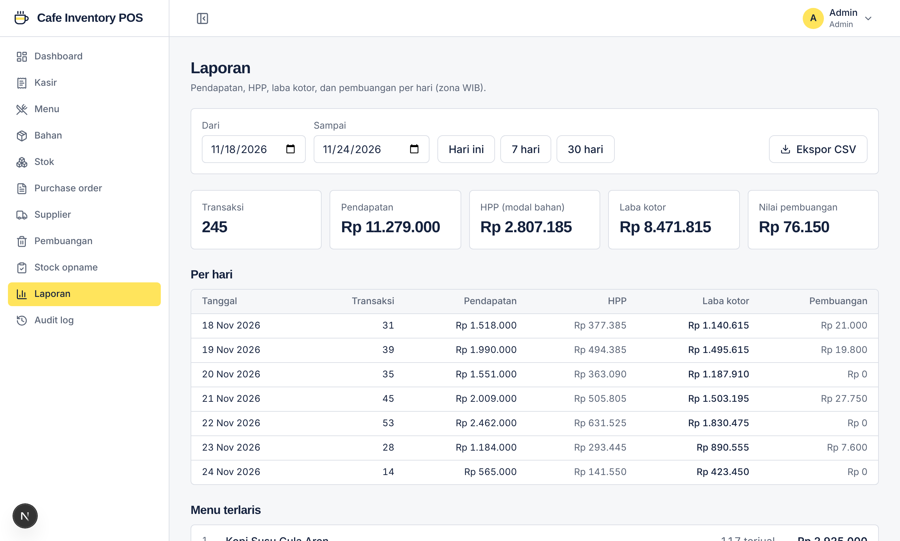
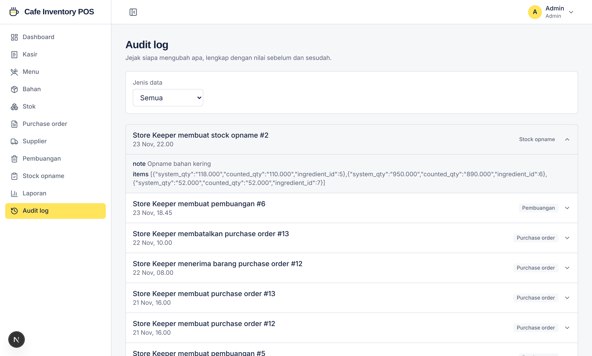
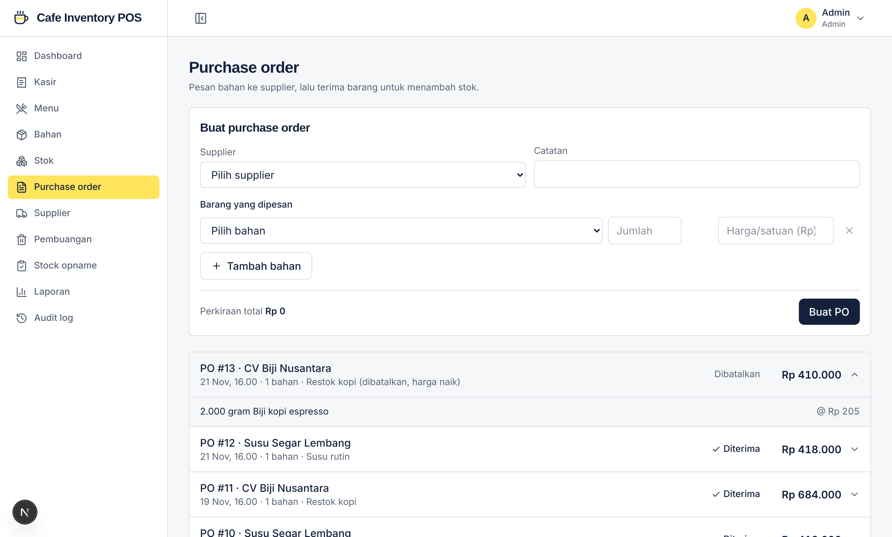
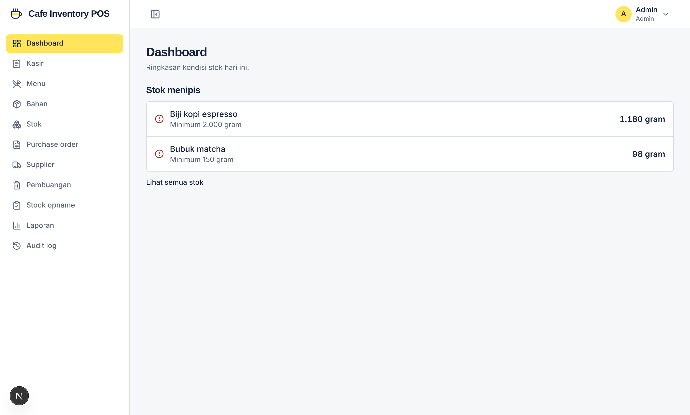

# Cafe Inventory POS

Sistem inventori dan kasir (POS) untuk kafe dengan **stok berbasis resep**: setiap penjualan memotong bahan baku sesuai resep menu, dari batch yang paling dulu kedaluwarsa (FEFO), aman walaupun banyak kasir menjual bersamaan.

[](https://github.com/fauzanrakha68/cafe-inventory-pos/actions/workflows/ci.yml)

Proyek portofolio: Express 5 + TypeScript + PostgreSQL di backend, Next.js 16 + Tailwind v4 di frontend, 63 tes otomatis (termasuk tes konkurensi) yang jalan di CI.

## Tampilan

| | |
|---|---|
|  **Kasir**: keranjang, stok terpotong otomatis |  **Stok**: penanda "Menipis" per bahan |
|  **Laporan**: pendapatan, HPP, laba kotor, ekspor CSV |  **Audit log**: nilai sebelum dan sesudah |
|  **Purchase order**: terima barang jadi batch |  **Dashboard** |

## Fitur

**Inti**
- Login dengan tiga peran: `admin`, `kasir`, `store_keeper`, dengan hak akses dicek di backend.
- Data master: bahan (satuan gram, ml, pcs, stok minimum), menu, dan resep per menu.
- Stok per batch dengan tanggal kedaluwarsa dan harga beli.
- Kasir (POS): penjualan memotong bahan sesuai resep secara FEFO. Stok kurang berarti ditolak, dan seluruh transaksi dibatalkan.
- Peringatan stok menipis berdasarkan stok minimum (batch kedaluwarsa tidak dihitung sebagai stok tersedia).

**Tambahan**
- Purchase order dan supplier: PO dibuat, diterima (otomatis membuat batch), atau dibatalkan.
- Stock opname: hitung fisik lawan catatan sistem, selisih menyesuaikan stok dan tercatat.
- Pembuangan bahan (kedaluwarsa, rusak, tumpah, lainnya).
- Laporan harian per rentang tanggal: pendapatan, HPP, laba kotor, nilai pembuangan, menu terlaris, ekspor CSV.
- Audit log: siapa mengubah apa, dengan nilai sebelum dan sesudah.

## Keputusan desain

**Stok = jumlah sisa batch, dengan buku besar.** Tidak ada satu angka "stok" yang bisa diedit sembarangan. Stok tiap bahan adalah jumlah `remaining_qty` dari batch-nya, dan setiap perubahan juga ditulis ke tabel `stock_movements` (receive, sale, waste, opname). Dua sumber ini harus selalu cocok, dan skrip seed mengecek hal itu.

**Konkurensi pada penjualan.** Satu penjualan adalah satu transaksi database: bahan dikunci urut berdasarkan id (mencegah deadlock antar kasir), batch dikunci dengan `for update` dan diambil urut `expires_at, id` (FEFO). Kalau stok kurang, API membalas `409` dengan nama bahannya dan seluruh transaksi di-rollback. Ada tes dua penjualan serentak untuk stok yang hanya cukup satu: satu berhasil, satu 409, stok tidak pernah minus. Penerimaan PO mengunci baris PO, jadi dua penerimaan serentak hanya menghasilkan satu batch.

**Tidak ada float untuk jumlah dan uang.** Uang disimpan sebagai bilangan bulat rupiah. Jumlah bahan memakai `numeric(14,3)` dan dihitung di aplikasi dalam BigInt per seperseribu, jadi tidak ada galat pembulatan. Nilai `numeric` dari PostgreSQL tetap berupa string sampai ke tampilan.

**HPP akurat per batch.** Karena setiap pengurangan stok mencatat batch asalnya, HPP penjualan dihitung dari harga beli batch yang benar-benar terpakai, bukan rata-rata. Kenaikan harga beli antar PO langsung tercermin di laporan.

**Zona waktu WIB.** "Hari ini", pergantian hari di laporan, dan batas kedaluwarsa dihitung dalam `Asia/Jakarta`, bukan zona server.

**Audit atomik.** Catatan audit ditulis di transaksi yang sama dengan perubahan datanya. Aksi yang gagal tidak meninggalkan jejak, dan password tidak pernah masuk log.

**Keamanan dasar.** Password di-hash dengan bcrypt, sesi memakai JWT, validasi input dengan zod, query selalu berparameter, dan ekspor CSV menetralkan sel yang diawali `=`, `+`, `-`, `@` (CSV injection).

## Stack

- **Backend:** Node.js, Express 5, TypeScript, `pg` (SQL mentah, tanpa ORM), zod, bcryptjs, jsonwebtoken
- **Database:** PostgreSQL 16 (migrasi berupa file SQL berurutan)
- **Frontend:** Next.js 16 (App Router), React, Tailwind CSS v4, lucide-react
- **Tes:** Vitest + supertest
- **CI:** GitHub Actions (PostgreSQL service; tipe, migrasi, tes backend; lint, tipe, dan build frontend)

## Struktur

```
backend/
  migrations/        skema SQL berurutan (001_init, 002_operations)
  src/routes/        auth, users, ingredients, menus, stock, sales, waste,
                     opnames, suppliers, purchaseOrders, reports, audit
  src/stockOps.ts    kunci batch, alokasi FEFO, pencatatan buku besar
  src/audit.ts       pencatat audit
  src/seedDemo.ts    data demo 14 hari
  src/__test__/      tes integrasi
frontend/
  src/app/           halaman (kasir, stok, bahan, menu, PO, laporan, audit, dst.)
  src/components/    AppShell (sidebar, navbar, menu profil)
docker-compose.yml   PostgreSQL untuk pengembangan
```

## Menjalankan

Butuh Node.js 20+ dan Docker.

```bash
# 1. database
docker compose up -d

# 2. backend
cd backend
cp .env.example .env        # Windows (cmd): copy .env.example .env
npm install
npm run migrate
npm run seed:demo           # data demo 14 hari (kafe fiktif "Kopi Senja")
npm run dev                 # http://localhost:4000

# 3. frontend (terminal lain)
cd frontend
npm install
npm run dev                 # http://localhost:3000
```

Isi `JWT_SECRET` di `backend/.env` dengan string acak. Frontend memanggil `http://localhost:4000` secara bawaan; ubah lewat `NEXT_PUBLIC_API_URL` bila perlu.

Akun demo (password semuanya `password123`):

| Email | Peran |
|---|---|
| `admin@cafe.test` | admin (semua halaman, laporan, audit log) |
| `kasir@cafe.test`, `kasir2@cafe.test` | kasir (kasir, melihat menu) |
| `store@cafe.test` | store keeper (bahan, stok, PO, supplier, pembuangan, opname) |

`npm run seed:demo` menolak jalan kalau database sudah berisi data; tambahkan `-- --reset` untuk menimpanya.

## Tes

```bash
cd backend
npm test
```

63 tes integrasi terhadap database sungguhan, antara lain:
- hak akses per peran,
- FEFO dan batch kedaluwarsa yang tidak dijual,
- penjualan serentak untuk stok yang hanya cukup satu,
- penerimaan PO serentak (hanya satu yang berhasil),
- pembuangan dan opname (termasuk rollback seluruh opname bila satu bahan gagal),
- perhitungan laporan per hari WIB dan keamanan CSV,
- audit log (nilai sebelum dan sesudah, aksi gagal tidak tercatat).

## Batasan dan rencana

Sengaja belum dikerjakan: konversi satuan (kg ke gram), pembatalan penjualan (void), multi-cabang, penerimaan PO sebagian, dan halaman manajemen pengguna (endpoint `POST/GET /users` sudah ada). Harga beli disimpan sebagai rupiah bulat per satuan dasar, sehingga bahan yang harganya di bawah Rp1 per satuan memerlukan presisi lebih halus.